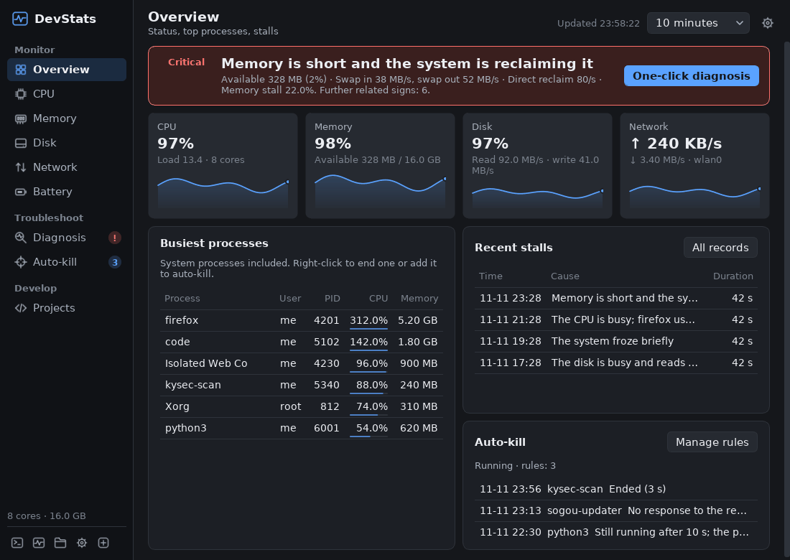
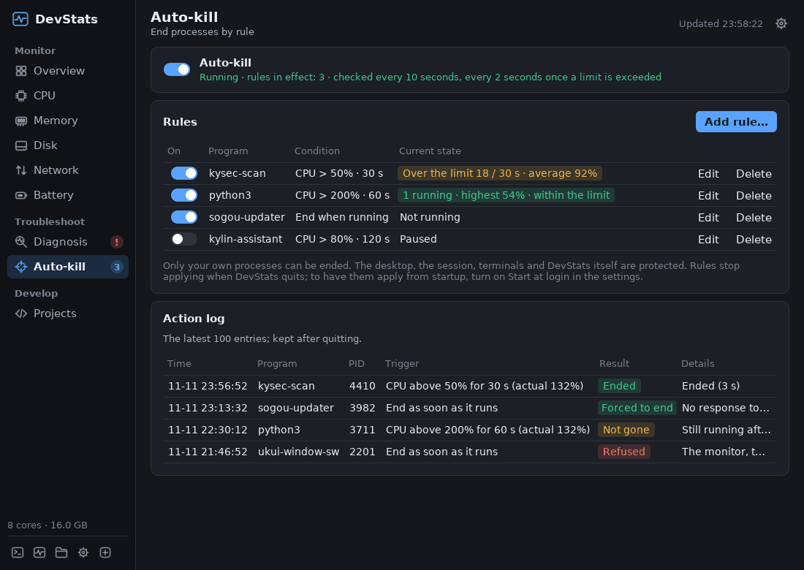
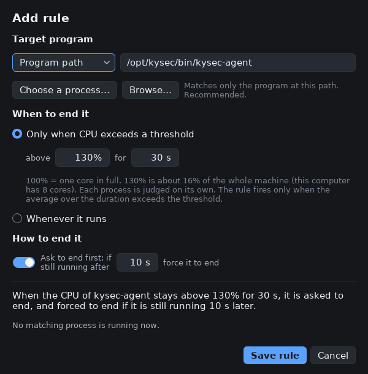
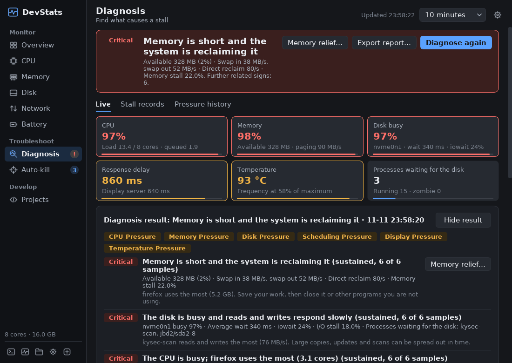
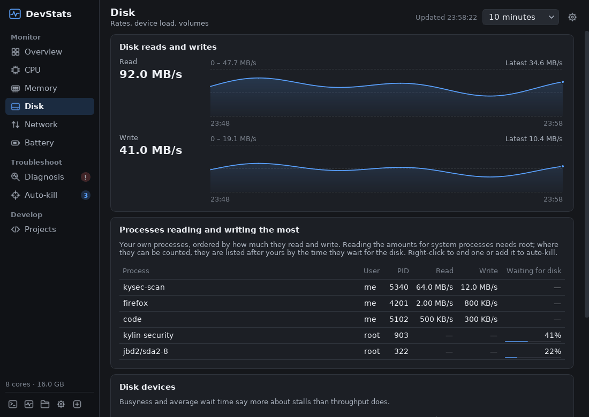
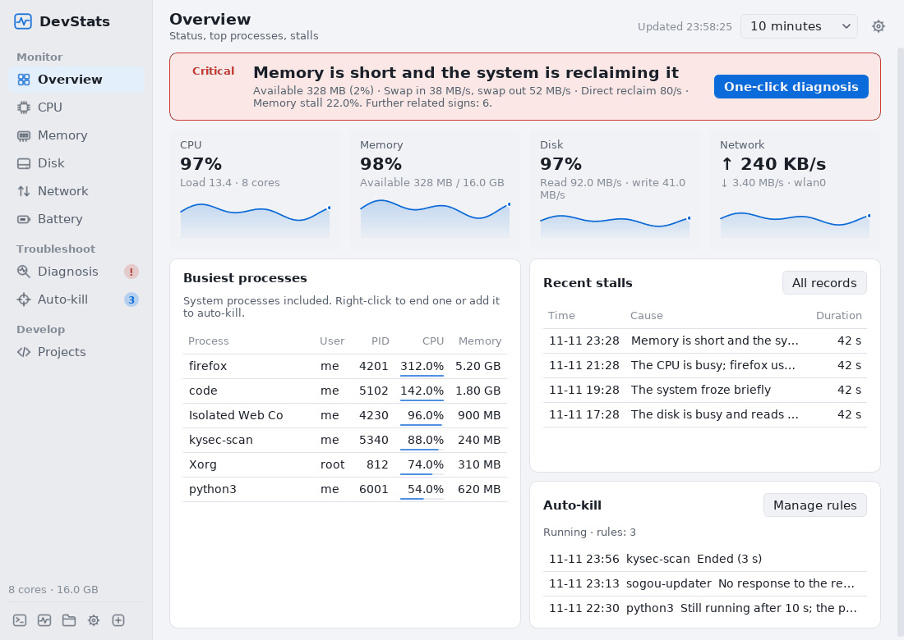

# DevStats for Kylin

[简体中文](README.md) | **English**

**A system monitor for Kylin laptops: it shows why the computer stalls, and ends runaway programs by rule.**

For Kylin Desktop V10 SP1 (ARM64). It installs for an ordinary user, needs no root and changes no system directory. Written in Qt 5 / C++17; it only reads `/proc` and `/sys`. The interface comes in Simplified Chinese and English.



## Why

On these laptops a stall often comes from the background: security software scanning the disk, a sync or office component holding the CPU for a long time, memory running short and the system starting to swap. The monitor that comes with the system only gives numbers. It does not say why the desktop stalls or which program is behind it, and a program that keeps running away has to be ended by hand every time.

DevStats for Kylin does two things:

1. **Auto-kill for runaway programs**: set a rule for a program, such as “end it when its CPU stays above 80% for 30 seconds”.
2. **Stall diagnosis and system monitoring**: stalls are measured directly, with their cause and the processes involved. Root processes and kernel threads are in the rankings too.

## Auto-kill for runaway programs



A rule answers three questions:

| | Options |
| --- | --- |
| **Which program** | The full path of the program (recommended) or its exact name; command lines and partial text are not matched |
| **When** | **CPU above X% for Y seconds** (80% and 30 seconds by default), or whenever it runs |
| **How** | SIGTERM first; optionally SIGKILL if it is still running after N seconds (on by default, after 10 seconds) |

- **How CPU is counted**: 100% is one core in full, as in `top`. The rule editor converts it to a share of the whole machine: on an 8-core machine 80% is about 10% of the machine. Each process is judged on its own; the processes of one program are not added up.
- **How the duration is counted**: by the average over the period. A brief dip does not restart the countdown; it is cancelled only when the average falls below the threshold. A duration of 0 means the program is ended as soon as it exceeds the limit.
- **How often it is checked**: about every 10 seconds; every 2 seconds while a process is over the limit or being waited on to exit.
- **Live state**: each rule shows `Not running`, `1 running · highest 34% · within the limit`, `Over the limit 18 / 30 s · average 92%`, `The process did not respond to the request to end` and so on.
- **Action log**: DevStats confirms whether the process really exited and shows `Ended (3 s)`, `Forced to end` or `Not gone`. The latest 100 entries are kept, and neither an upgrade nor an uninstall deletes them.
- **Adding a rule**: right-click a process on the overview, on the diagnosis page or in any process list to add it directly.



### Safety limits

- Only processes of the current ordinary user that are not elevated are ended. Root processes can be seen but not ended; the system, the desktop, the session, terminals and DevStats itself are protected.
- Before each signal the PID, the start time, all UIDs and the program path are checked again, and the signal goes through a stable process handle (`pidfd_send_signal`), so a reused PID cannot be hit by mistake. Where the kernel does not support this, DevStats refuses rather than falling back to a signal by PID number.
- The main switch is off by default and asks once when it is turned on. Saving a “Whenever it runs” rule while matching processes are already running lists them and asks again. Turning the main switch off takes effect at once.
- A program that keeps restarting is backed off from 30 seconds up to 5 minutes, and a process that does not respond to the request to end is not signalled again and again. At most 8 processes are handled per round.
- SIGKILL gives a program no chance to save its data; it can be turned off in the rule.
- Rules apply only while DevStats runs. To have them apply from startup, turn on “Start DevStats at login” in the settings.

## Stall diagnosis



- **Stalls are measured directly**: one thread measures scheduling delay every 200 milliseconds (how late it wakes up), and another sends a round-trip request to the X server every second to measure how the desktop responds. During a one-click diagnosis these rise to 50 and 5 times a second.
- **No dependence on PSI**: some Kylin kernels have no PSI. DevStats also looks at disk busyness and average wait (`/proc/diskstats`), direct memory reclaim (`/proc/vmstat`), run-queue delay (`/proc/schedstat`), temperature and frequency throttling (`/sys`), the share of interrupts and the rate of new processes (`/proc/stat`). None of it needs root.
- **Finds the program that keeps starting commands**: short-lived processes are often gone between two scans. When a parent waits for them to end, the kernel accounts the CPU they used to the parent; from that DevStats tells which program keeps starting commands and how much CPU those commands used, also for root services.
- **Sees every process**: `/proc/PID/stat` is readable by everyone, so root's security software, `Xorg`, `kswapd0`, `jbd2` and the like are in the rankings; their paths and command lines are not read.
- **Conclusion first**: one sentence, then six indicators, the problems found (each with its evidence and a suggestion) and the related processes (right-click to end one or add it to auto-kill).
- **One-click diagnosis**: observes for about 10 seconds, tells sustained problems from occasional ones and gives each process's average and peak.
- **Stall records**: on sustained pressure, a short freeze (1 second or more) or a stuck desktop (3 seconds or more), the evidence of that moment is saved automatically, kept for 31 days, and can be exported.
- **Exported reports**: a diagnosis and a stall record can each be exported as a single HTML file that opens and prints in a browser without a network connection; the raw data is at the end of the page. Reports contain no command lines and no program paths.

The programs in the rankings are the busiest ones at the time of the stall. That is a strong correlation, but not proof of the cause. GPU load, lock waits inside an application and network latency cannot be measured.

## System monitoring

- **Overview**: a status banner; four cards with charts for CPU, memory, disk and network; the busiest processes, recent stalls and what auto-kill did.
- **Pages**: CPU (load per core, frequency, temperature), memory, disk (busyness, average wait, the processes reading and writing the most), network (TCP ranking by application, upload above download), battery, development projects.
- The history is kept by the minute for 31 days. The tray icon shows CPU, memory, network and battery by default. The interface can be dark, light or follow the system.



“Processes reading and writing the most” on the Disk page orders the current user's processes by bytes read and written. The amounts for root processes can only be read by root, so those are ordered after them by the time they spent waiting for the disk (this needs per-process delay accounting in the kernel, which Kylin's 5.4 kernel has on by default).



## Language

The interface comes in Simplified Chinese and English. By default it follows the system: Chinese when the system language is Chinese (`LC_ALL`, `LC_MESSAGES`, `LANG`, and the first entry of `LANGUAGE`), English for any other language. In the settings, “Language” can be fixed to 中文 or English; the change applies at once, without a restart. Stall records and action-log entries saved before a change keep the words they were saved with.

## Install

Download `devstats-<version>-linux-arm64-user.tar.gz` from [Releases](../../releases) and run on the Kylin computer:

```bash
tar -xzf devstats-1.0.0-linux-arm64-user.tar.gz
cd devstats-1.0.0-linux-arm64-user
./install-user.sh
```

Then open **DevStats** from the application menu, or run `~/.local/bin/devstats --show`.

- The package brings its own Qt runtime. It needs no sudo, installs no system packages and does not touch the system's Qt.
- Before upgrading, quit the running DevStats from the tray menu. “Start DevStats at login”, if it is on, is switched to the new version automatically.
- Uninstall: run `~/.local/bin/devstats-uninstall`. Settings and history are kept.

The full instructions are in the [installation and user guide](packaging/README-user.en.md). Requirements: Kylin V10 SP1 ARM64, glibc 2.31 or newer, an X11 or Wayland graphical session; see [target environment](TARGET-ENVIRONMENT.md) (in Chinese).

## Overhead

System metrics are sampled every 2 seconds. Processes are scanned every 10 seconds in the background, and every 2 seconds while the window is visible, a diagnosis is running or a rule is over its limit. With only the tray icon, on the x86_64 test machine, DevStats takes about 0.5% of one core and about 26 MiB of memory.

The more processes the current user has, the more a scan costs. With 150 processes of the current user simulated on the x86_64 test machine, DevStats takes about 1.9% of one core right after its window opens, about 2.3% after the window has been open for 10 minutes, and about 0.6% with only the tray icon. Version 0.8.5 took 3.7% after 10 minutes: the history charts were resent and redrawn in full every 2 seconds, so the cost grew with the time the window stayed open. Now only new points are sent and the charts are drawn in strips; a longer time range and noisier data still cost more to redraw, but far less. DevStats' own usage is never taken for the cause of a stall by the diagnosis. It rises briefly when the window opens and during a one-click diagnosis, and it is marked “(this tool)” in the process lists.

## Build from source

On ARM64 Linux with the system's Qt 5 development packages:

```bash
sudo apt install build-essential qtbase5-dev qt5-qmake libqt5sql5-sqlite
./scripts/build-linux-arm64.sh
./scripts/package-linux.sh
```

Or cross-compile on x86_64 Linux with an isolated SDK (ARM64 Qt 5.12.8, glibc 2.31 and GCC 9 from Ubuntu 20.04 focal) and build the package that installs without root:

```bash
export SDK=/path/to/isolated-sdk
export PATH="$SDK/host/usr/bin:$PATH" LD_LIBRARY_PATH="$SDK/host-runtime"
./scripts/build-linux-arm64.sh --qmake "$SDK/host/usr/lib/qt5/bin/qmake" \
  --sysroot "$SDK/sysroot" --qt-host-prefix "$SDK/host/usr"
python3 scripts/package-linux-user.py --binary build/linux-arm64/devstats --sysroot "$SDK/sysroot" \
  --archives "$SDK/apt-target/var/cache/apt/archives" --output-dir dist
```

`VERSION` is the single source of the version number.

## Interface text

Interface text is written in Chinese where it is used, inside `T("…")`, `Tn("…", count)` for text about a count, or `Tc("context", "…")` where one Chinese word needs different English words. `src/assets/i18n-en.json` maps each text to English. `scripts/check-i18n.py` keeps the two in step and runs with the tests: every text has an English entry, placeholders and HTML tags agree, no Chinese is left in the English, and no Chinese literal stays outside `T()`.

## Tests

```bash
# Each test reuses the object files already built and is compiled and linked once
python3 scripts/run-tests.py --mode native --build-dir build/native --work-dir build/tests \
  --sdk "$SDK" --native-runtime /path/to/native-runtime [--display :N] [test names...]
python3 scripts/run-tests.py --mode arm --build-dir build/linux-arm64 --work-dir build/tests-arm --sdk "$SDK"
# The real application, real processes, real CPU load
python3 tests/test_cpu_limit_e2e.py build/native/devstats
python3 scripts/test-linux-user.py
python3 scripts/test-linux-uninstall.py
python3 tests/test_prefix_paths.py
```

`tests/test_ui_preview` renders every page from synthetic data as PNG files, dark and light, at the normal and the smallest window size, in Chinese and in English. It checks that no control reaches outside the window, that the layout is not squeezed, and that the English pages have no Chinese left. The screenshots above come from it.

## Known limits

- Verified mainly on the x86_64 test machine, in QEMU and under Xvfb. The tray, themes, Wayland/Xwayland, the battery, temperature sensors and real performance need more feedback from real Kylin machines.
- The diagnosis thresholds come from experience and are not calibrated for each model.
- Only the current user's processes can be ended, and CPU is judged per process.
- The file chooser shown when exporting a report is provided by Qt or the desktop, and its language does not follow the setting in DevStats.

Changes by version are in the [CHANGELOG](CHANGELOG.md) (in Chinese; the release notes are in both languages).

## License

MIT, see [LICENSE](LICENSE). The macOS edition of DevStats is based on [Stats](https://github.com/exelban/stats) (MIT); this repository is an independent Qt/C++ implementation for Kylin under the same MIT license.
