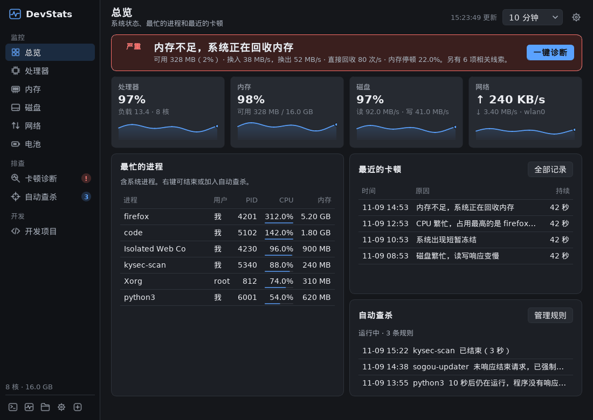
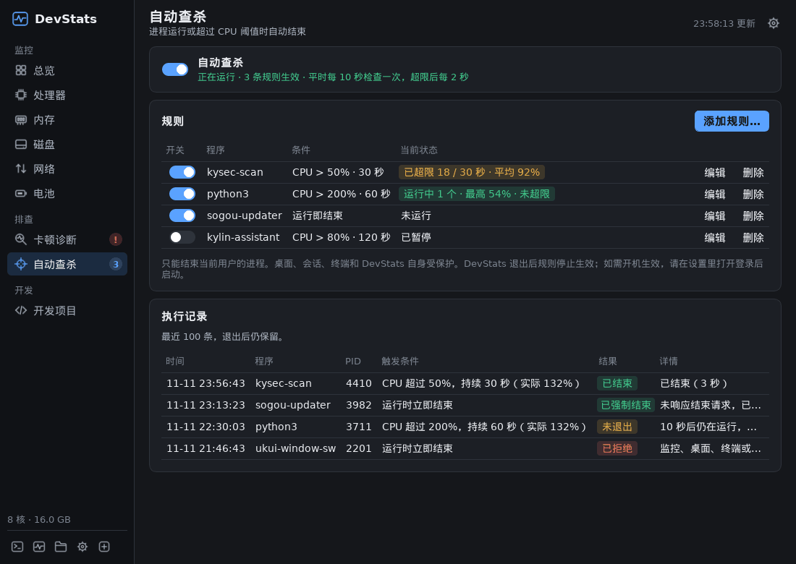
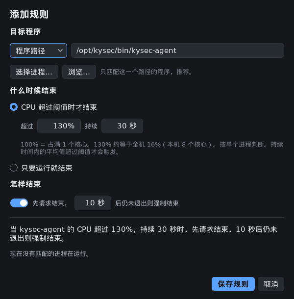
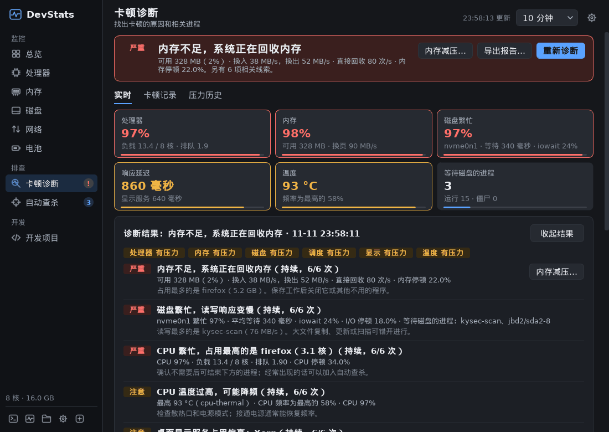
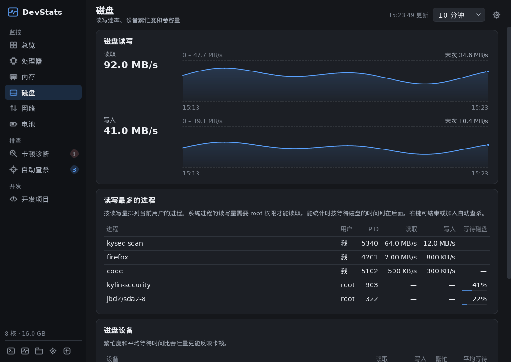
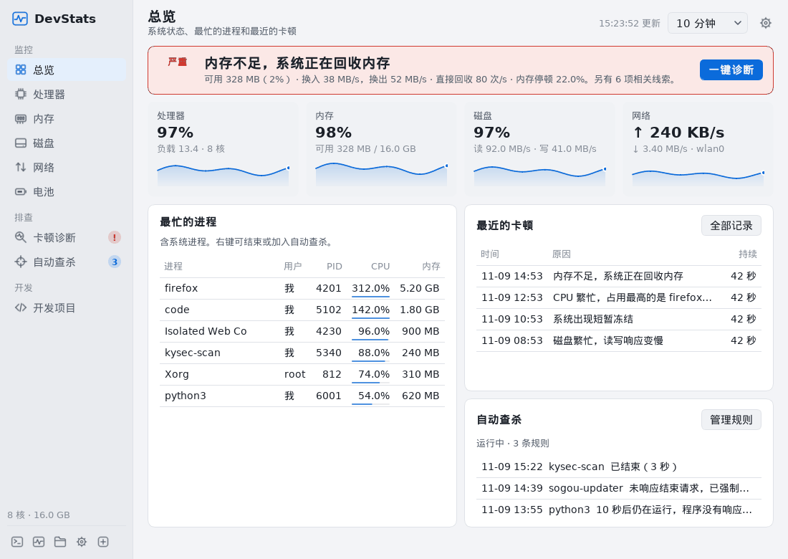

# DevStats 麒麟版

**银河麒麟信创本的系统监控：看清电脑为什么卡，并按规则自动结束失控的程序。**

适用于银河麒麟桌面操作系统 V10 SP1（ARM64）。普通用户安装，不需要 root，不改系统目录。Qt 5 / C++17 实现，只读取 `/proc` 和 `/sys`。

*A system monitor for Kylin Desktop V10 (ARM64) laptops: it explains why the desktop stalls and ends runaway programs by rule, such as "CPU above 80% for 30 seconds". Installs per user, no root required.*



## 为什么做这个

信创本上的卡顿常常来自后台：安全软件扫盘、同步或办公组件长时间占满 CPU、内存不够开始换页。系统自带的监视器只给出数字，说不清“为什么卡、是谁在卡”；反复失控的程序也只能每次手动结束。

DevStats 麒麟版做两件事：

1. **异常程序自动查杀**：给指定程序定规则，例如“CPU 超过 80%，持续 30 秒就结束”。
2. **卡顿诊断与系统监控**：直接测量卡顿，指出原因和相关进程，root 进程和内核线程也在排行里。

## 异常程序自动查杀



一条规则回答三个问题：

| | 选项 |
| --- | --- |
| **结束谁** | 完整程序路径（推荐）或精确程序名；不匹配命令行或部分文字 |
| **什么时候** | **CPU 超过 X%，持续 Y 秒**（默认 80%、30 秒），或只要运行就结束 |
| **怎样结束** | 先发 SIGTERM；可选 N 秒后仍未退出再发 SIGKILL（默认开启，等 10 秒） |

- **CPU 怎么算**：100% 等于占满 1 个核心，和 `top` 一致。编辑规则时会换算成整机占比，比如 8 核机器上 80% 约等于整机 10%。按单个进程判断，同一程序的多个进程不合计。
- **持续怎么算**：看这段时间的平均值，短暂回落不会让倒计时重来，平均值降到阈值以下才取消。持续时间设为 0 表示一超过就结束。
- **检查频率**：平时约 10 秒一次；有进程超限或正在等待退出时提高到 2 秒一次。
- **实时状态**：每条规则显示 `未运行`、`运行中 · 最高 34% · 未超限`、`已超限 18 / 30 秒 · 平均 92%`、`进程没有响应结束请求` 等。
- **执行记录**：确认进程是否真的退出了，显示 `已结束（3 秒）`、`已强制结束` 或 `未退出`。保留最近 100 条，升级和卸载都不会删除。
- **加规则**：在总览、卡顿诊断或任意进程列表里右键一个进程，就能直接加入。



### 安全边界

- 只结束当前普通用户、未提权的进程。root 进程只能看，不能结束；系统、桌面、会话、终端和 DevStats 自身受保护。
- 每次发信号前都重新核对 PID、启动时间、所有 UID 和程序路径，并通过稳定的进程句柄（`pidfd_send_signal`）发送，不会因为 PID 被复用而误伤。内核不支持时明确拒绝，不退回按数字 PID 发送。
- 总开关默认关闭，打开时确认一次。保存“只要运行就结束”的规则时，如果当前已有匹配的进程，会列出来再确认。关掉总开关立即生效。
- 反复重启的程序按 30 秒起、最长 5 分钟退避；进程不响应结束请求时不再重复发送。每轮最多处理 8 个进程。
- SIGKILL 不给程序保存数据的机会，可以在规则里关掉。
- 规则只在 DevStats 运行时生效；需要开机就生效，在设置里打开“登录后启动”。

## 卡顿诊断



- **直接测量卡顿**：一个线程每 200 毫秒测一次调度延迟（醒来晚了多久），另一个每秒向 X 服务发一次往返请求，测桌面响应。一键诊断期间分别提高到每秒 50 次和 5 次。
- **不依赖 PSI**：部分麒麟内核没有 PSI。DevStats 还会看磁盘繁忙度和平均等待（`/proc/diskstats`）、直接内存回收（`/proc/vmstat`）、调度排队（`/proc/schedstat`）、温度和降频（`/sys`）、中断占比和新建进程速率（`/proc/stat`）。全部不需要 root。
- **看得到所有进程**：`/proc/PID/stat` 对所有人可读，所以 root 的安全软件、`Xorg`、`kswapd0`、`jbd2` 等也会进入排行；不会读取它们的路径和命令行。
- **结论先行**：一句话结论，然后是六个指标、发现的问题（每条有依据和建议）、相关进程（右键可结束或加入查杀）。
- **一键诊断**：观察约 10 秒，区分持续和偶发的问题，给出各进程的平均和峰值。
- **卡顿记录**：出现连续压力、短暂冻结（≥1 秒）或桌面卡住（≥3 秒）时，自动保存当时的证据，保留 31 天，可以导出。
- **导出报告**：诊断结果和卡顿记录都能导出成单个 HTML 文件，浏览器直接打开、打印，不需要联网；原始数据附在页面末尾。报告不含命令行和程序路径。

排行里的程序是卡顿时最忙的程序，相关性很强，但不等于已经证明是原因。GPU 负载、应用内部的锁等待和网络延迟测不到。

## 系统监控

- **总览**：状态横幅，CPU / 内存 / 磁盘 / 网络四张带曲线的卡片，最忙的进程、最近的卡顿和自动查杀情况。
- **各页面**：CPU（各核负载、频率、温度）、内存、磁盘（繁忙度、平均等待、读写最多的进程）、网络（按应用的 TCP 排行，上传在上、下载在下）、电池、开发项目。
- 历史按分钟保存 31 天。托盘图标默认显示 CPU、内存、网络、电池。界面可选深色、浅色或跟随系统。



磁盘页的“读写最多的进程”按读写字节数排列当前用户的进程。root 进程的读写量需要 root 才能读取，改按等待磁盘的时间排在后面（需要内核开启进程延迟统计，麒麟的 5.4 内核默认开启）。



## 安装

从 [Releases](../../releases) 下载 `devstats-<版本>-linux-arm64-user.tar.gz`，在麒麟电脑上运行：

```bash
tar -xzf devstats-0.8.4-linux-arm64-user.tar.gz
cd devstats-0.8.4-linux-arm64-user
./install-user.sh
```

然后从应用菜单打开 **DevStats**，或运行 `~/.local/bin/devstats --show`。

- 安装包自带 Qt 运行库，不需要 sudo，不安装系统软件包，也不修改系统 Qt。
- 升级前先从托盘菜单退出正在运行的 DevStats。已开启的“登录后启动”会自动改为启动新版本。
- 卸载：运行 `~/.local/bin/devstats-uninstall`，设置和历史数据会保留。

完整说明见 [安装与使用说明](packaging/README-user.md)。系统要求：麒麟 V10 SP1 ARM64、glibc 2.31 或更新、X11 或 Wayland 图形会话，详见 [目标环境](TARGET-ENVIRONMENT.md)。

## 开销

系统指标每 2 秒采样一次；进程在后台每 10 秒扫描一次，窗口可见、诊断中或有规则超限时改为每 2 秒一次。在 x86_64 测试机上只开托盘时，约占单核 0.5% 的 CPU，内存约 26 MiB。

## 从源码构建

在 ARM64 Linux 上用系统 Qt 5 开发包：

```bash
sudo apt install build-essential qtbase5-dev qt5-qmake libqt5sql5-sqlite
./scripts/build-linux-arm64.sh
./scripts/package-linux.sh
```

或者在 x86_64 Linux 上用隔离 SDK 交叉编译（Ubuntu 20.04 focal 的 ARM64 Qt 5.12.8、glibc 2.31、GCC 9），并打成免 root 安装包：

```bash
export SDK=/path/to/isolated-sdk
export PATH="$SDK/host/usr/bin:$PATH" LD_LIBRARY_PATH="$SDK/host-runtime"
./scripts/build-linux-arm64.sh --qmake "$SDK/host/usr/lib/qt5/bin/qmake" \
  --sysroot "$SDK/sysroot" --qt-host-prefix "$SDK/host/usr"
python3 scripts/package-linux-user.py --binary build/linux-arm64/devstats --sysroot "$SDK/sysroot" \
  --archives "$SDK/apt-target/var/cache/apt/archives" --output-dir dist
```

`VERSION` 是版本号的唯一来源。

## 测试

```bash
# 每个测试复用已构建的目标文件，只编译和链接一次
python3 scripts/run-tests.py --mode native --build-dir build/native --work-dir build/tests \
  --sdk "$SDK" --native-runtime /path/to/native-runtime [--display :N] [测试名...]
python3 scripts/run-tests.py --mode arm --build-dir build/linux-arm64 --work-dir build/tests-arm --sdk "$SDK"
# 真实应用、真实进程、真实 CPU 负载
python3 tests/test_cpu_limit_e2e.py build/native/devstats
python3 scripts/test-linux-user.py
python3 scripts/test-linux-uninstall.py
python3 tests/test_prefix_paths.py
```

`tests/test_ui_preview` 用合成数据把所有页面按深色、浅色、正常和最小窗口渲染成 PNG，并检查控件有没有超出窗口、布局有没有被压缩。上面的截图就来自它。

## 已知限制

- 主要在 x86_64 测试机、QEMU 和 Xvfb 上验证。托盘、主题、Wayland/Xwayland、电池、温度传感器和真实性能还需要更多麒麟实机反馈。
- 诊断阈值来自经验，没有针对每种机型校准。
- 只能结束当前用户的进程；CPU 按单个进程判断。

版本变化见 [CHANGELOG](CHANGELOG.md)。

## 许可证

MIT，见 [LICENSE](LICENSE)。DevStats 的 macOS 版基于 [Stats](https://github.com/exelban/stats)（MIT）；本仓库是面向麒麟的独立 Qt/C++ 实现，沿用同一 MIT 许可证。
